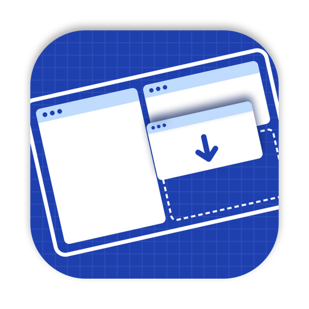

<p align="center">
  
</p>

<h1 align="center">Snapback</h1>

<p align="center">
  Save your window layout across all your monitors, then snap every app back into place with one hotkey.
</p>

<p align="center">
  
  
</p>

---

Arrange your windows the way you like them, press <kbd>Caps Lock</kbd> <kbd>S</kbd> to save, and press <kbd>Caps Lock</kbd> <kbd>R</kbd> whenever things get messy. Snapback remembers a separate layout for each monitor setup, so "laptop only" and "docked with two displays" each keep their own.

It's a small native menu bar app with no dependencies. It also turns Caps Lock into a **Hyper key**: hold it with any key for <kbd>⌃</kbd><kbd>⌥</kbd><kbd>⇧</kbd><kbd>⌘</kbd>, tap it on its own for <kbd>Esc</kbd>, or hold it on its own to **pick a window by number**.

## Contents

- [Features](#features)
- [Installation](#installation)
- [Usage](#usage)
- [How it works](#how-it-works)
- [Troubleshooting](#troubleshooting)
- [Uninstalling](#uninstalling)
- [Development](#development)

## Features

- **One-key restore:** every app's windows go back to their saved position and size.
- **Multi-monitor aware:** windows are saved relative to their display, identified by hardware ID. Rearranging displays or changing resolution doesn't break your layout.
- **A layout per display setup:** the layout that matches the monitors you have plugged in is the one that gets restored.
- **Per app, not per window:** each window goes to the nearest saved spot for its app, so it works even after an app restarts.
- **Hyper key:** Caps Lock becomes <kbd>⌃</kbd><kbd>⌥</kbd><kbd>⇧</kbd><kbd>⌘</kbd> when held, a modifier no app uses, so you can bind conflict-free shortcuts. A quick tap is <kbd>Esc</kbd>.
- **Window picker:** hold Caps Lock and every visible window gets a big number. Press it to jump straight to that window, on any display.
- **Lightweight:** a menu bar icon, no Dock icon, starts at login.

## Installation

### Option 1: Download a release

Requires macOS 11 Big Sur or later.

1. Download the latest `Snapback-<version>.zip` from [Releases](https://github.com/harisjlatif/snapback/releases/latest) and unzip it.
2. Run the install script in Terminal:

   ```sh
   cd ~/Downloads/Snapback-*/
   ./install.sh
   ```

> [!NOTE]
> Release builds are ad-hoc signed, not notarized by Apple. The install script clears the download quarantine flag so macOS will run the app.

### Option 2: Build from source

Requires macOS 11 or later and the Xcode Command Line Tools (`xcode-select --install`).

```sh
git clone https://github.com/harisjlatif/snapback.git
cd snapback
make install
```

Either way, `Snapback.app` is copied to `~/Applications` and a LaunchAgent starts it at login.

### Grant Accessibility access

Snapback needs Accessibility access to move other apps' windows and to read the Caps Lock key. On first launch it explains this and offers to open System Settings:

1. Click **Open System Settings**.
2. Turn on **Snapback** under **Privacy & Security → Accessibility**.

Snapback notices straight away and confirms when it's ready, with no restart needed.

## Usage

| Shortcut | Action |
| --- | --- |
| <kbd>Caps Lock</kbd> <kbd>S</kbd> or <kbd>⌃</kbd><kbd>⌥</kbd><kbd>⌘</kbd><kbd>S</kbd> | Save the current layout for this display setup |
| <kbd>Caps Lock</kbd> <kbd>R</kbd> or <kbd>⌃</kbd><kbd>⌥</kbd><kbd>⌘</kbd><kbd>R</kbd> | Restore it |
| Hold <kbd>Caps Lock</kbd> + any key | That key with <kbd>⌃</kbd><kbd>⌥</kbd><kbd>⇧</kbd><kbd>⌘</kbd> (Hyper) |
| Tap <kbd>Caps Lock</kbd> | <kbd>Esc</kbd> |
| Hold <kbd>Caps Lock</kbd> on its own | Show the window picker |
| Hold <kbd>Caps Lock</kbd> + <kbd>1</kbd>…<kbd>0</kbd> | Focus that window |

You'll hear a short sound and see a ✓ in the menu bar after each save or restore.

The menu bar icon also has:

- **Save Layout** and **Restore Layout**
- The number of apps saved for the current display setup, and when
- **Caps Lock as Hyper Key**: turn it off to get normal Caps Lock back
- **Tap Caps Lock for Escape**
- **Hold Caps Lock to Pick a Window**

### Window picker

Hold <kbd>Caps Lock</kbd> for a moment (0.2 s) without pressing anything else. Your displays dim and each visible window shows a large number with its app name. Keep holding <kbd>Caps Lock</kbd> and press a number to bring that window to the front. Release <kbd>Caps Lock</kbd> to dismiss without switching.

- Windows are numbered by position (left display first, then left to right), so the numbers stay put as you switch between windows.
- Windows that are almost entirely hidden behind others are skipped, and each number sits on the part of its window you can see.
- Up to 10 windows: <kbd>1</kbd>–<kbd>9</kbd>, then <kbd>0</kbd>.
- If you already know the number, <kbd>Caps Lock</kbd> + number works straight away, before the overlay appears.

## How it works

**Saving** records every visible, non-minimised window of each regular app. Each window's frame is stored relative to the display it's mostly on, as fractions of that display's size.

**Restoring** looks up the layout for the currently connected displays. Each app's current windows are paired with its saved spots so the total movement is as small as possible. Windows beyond the number saved go to the app's main spot.

**The Hyper key** remaps Caps Lock to F18 at the keyboard-driver level using macOS's built-in `hidutil`. A keyboard event tap then turns F18 + key into ⌃⌥⇧⌘ + key, and a quick F18 tap into Escape. Quitting Snapback, or turning the setting off, gives Caps Lock back.

**The window picker** reads on-screen window positions from the window server (no Screen Recording permission needed), numbers them by position, and draws a dimmed overlay on each display. Picking a window raises it through the Accessibility API and activates its app. If macOS doesn't bring it to the front, Snapback falls back to activating the app the way the Dock does.

Layouts are stored in `~/Library/Application Support/Snapback/layouts.json`.

### Limitations

- Windows on other Spaces, minimised windows and full-screen windows aren't moved. macOS has no supported way for an app to move windows between Spaces.
- Some apps enforce a minimum window size or ignore resize requests.
- While the Hyper key is on, Caps Lock no longer toggles capitals.
- With the window picker on, <kbd>Caps Lock</kbd> + a number is used for switching windows, so it isn't passed to other apps as a Hyper shortcut.
- Snapback replaces any custom `hidutil` key remaps you've set up yourself. The **Modifier Keys** setting in System Settings isn't affected.

## Troubleshooting

#### A shortcut keeps asking for permission

Remove **Snapback** from **System Settings → Privacy & Security → Accessibility** with **–**, then run `make restart` and grant access again from the dialog.

#### Nothing happens when I restore

Restore only works for the display setup you saved on. The menu shows "No layout saved for this display setup" if there isn't one yet. Check the log for details:

```sh
make log
```

## Uninstalling

From a clone of the repo:

```sh
make uninstall
```

Or, if you installed from a release:

```sh
launchctl bootout gui/$(id -u)/com.snapback.Snapback
rm -f ~/Library/LaunchAgents/com.snapback.Snapback.plist
rm -rf ~/Applications/Snapback.app
```

Either way, this stops Snapback, gives Caps Lock back, and removes the app and LaunchAgent. You can then remove Snapback from the Accessibility list.

## Development

```
Sources/
  Layout.swift        Layout model and geometry (pure, unit tested)
  HyperKey.swift      Hyper key state machine (pure, unit tested)
  Picker.swift        Window picker numbering and badge placement (pure, unit tested)
  Overlay.swift       Window picker overlay, on-screen window list, focusing
  System.swift        Displays, Accessibility window access, hotkeys, Caps Lock remap, event tap
  main.swift          Menu bar app, save/restore, window picker, permission flow
Tests/
  main.swift          Tests (plain Swift, no XCTest required)
Resources/
  Info.plist          App bundle metadata
  make-icon.swift     Draws the app icon with CoreGraphics
scripts/
  install.sh          Installs the app and LaunchAgent (used by make install and release zips)
.github/workflows/
  release.yml         Tests, builds and publishes a release on every push to main
```

| Command | Description |
| --- | --- |
| `make build` | Build `build/Snapback.app` |
| `make test` | Run the tests |
| `make install` | Build, install to `~/Applications` and start at login |
| `make dist VERSION=x.y.z` | Build a release zip |
| `make restart` | Restart the running app |
| `make log` | Follow `~/Library/Logs/Snapback.log` |
| `make uninstall` | Stop and remove everything |
| `make clean` | Delete build output |

The app is ad-hoc signed with a designated requirement based on its bundle identifier, so rebuilding keeps the Accessibility permission.

### Releases

Every push to `main` triggers the [Release workflow](.github/workflows/release.yml). It runs the tests, builds the app and publishes a GitHub release with auto-generated notes. Pushes that only change Markdown or `docs/` are skipped.

Versions are `1.0.<run number>` and count up automatically. To bump the major or minor version, change `MAJOR_MINOR` in the workflow. You can also start a release by hand from the **Actions** tab.
